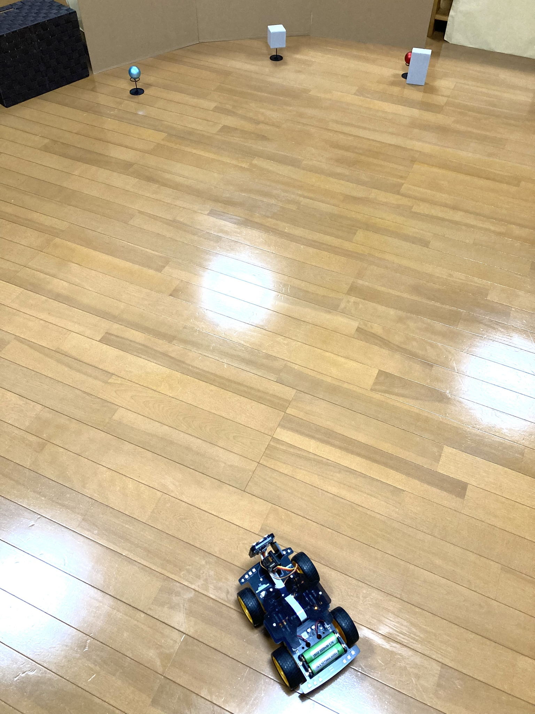
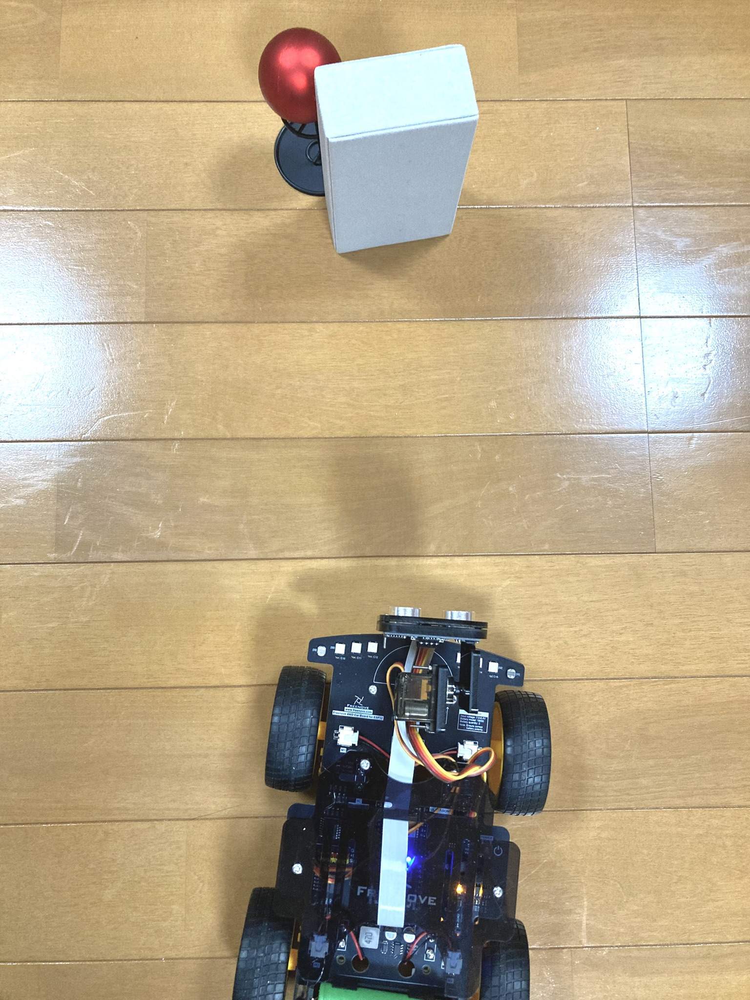
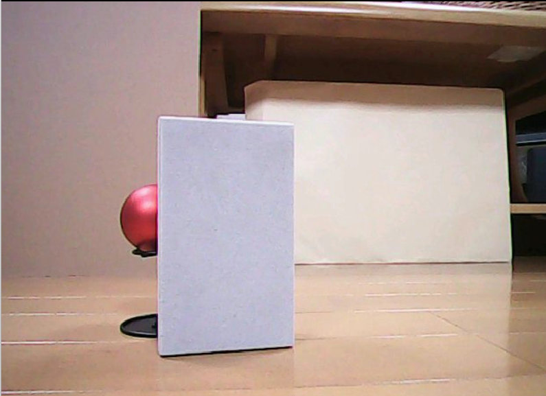

# NOEMA-CognitivePhysical

NOEMA-CognitivePhysical is an experimental, model-independent cognitive runtime for connecting general-purpose large language models to physical robotic systems.

This project explores whether an existing LLM can act as a cognitive controller for a physical body by repeatedly observing the environment, selecting actions, acquiring additional visual evidence, and updating its decisions in real time.

The implementation details of the cognitive runtime, internal state-transition logic, and evidence-acquisition architecture are intentionally omitted pending publication.

---

## Real-Robot Active Vision Test

### Model

**GPT-6.1 Terra**

### Robot Platform

**Freenove 4WD Robot Car ("Meridian")**

The robot is equipped with:

- a forward-facing camera with controllable horizontal gaze
- a front distance sensor
- basic forward and rotational movement
- text-to-speech output

The LLM does not directly operate motor values.  
Instead, it selects high-level observation and movement actions through the NOEMA-CognitivePhysical runtime.

---

## Task

The robot was given the following mission:

> Find the red ball placed on a black stand, stop in front of it, and report that the red ball has been found.

The target was intentionally placed behind a rectangular obstacle so that the red ball and its black stand were only partially visible from some viewpoints.

The environment also contained visually similar or distracting objects.

The task therefore required more than simple object detection.

The robot had to:

- inspect different viewing directions
- distinguish the target from distractors
- deal with partial occlusion
- change its body position when necessary
- reacquire the target from a new viewpoint
- approach the target
- stop before it
- report mission completion

---

## Initial View

The target was not directly identifiable from the initial frontal observation.

---

## Occlusion Setup

An external view of the physical scene shows the relationship between the robot, the rectangular occluder, and the red-ball target.

---

## Active Vision

During the task, GPT-6.1 Terra used both:

- **sensor-gaze actions**, in which the camera direction was changed while the robot body remained stationary
- **body-motion actions**, in which the robot changed its physical position or heading

The model first explored the scene visually, detected a partially visible red region, and continued gathering evidence before treating it as the target.

As the robot changed viewpoint and moved closer, the target became sufficiently identifiable as a red ball positioned on a black stand.

---

## Final Robot View

At the end of the run, the target remained partially occluded, but enough visual evidence had been acquired for the model to identify the red ball and black stand and complete the mission.

---

## Result

**GPT-6.1 Terra successfully completed the mission end-to-end on the physical robot.**

| Item | Result |
|---|---|
| Model | GPT-6.1 Terra |
| Robot | Meridian / Freenove 4WD |
| Task | Partially occluded red-ball search |
| Active Vision | Yes |
| Total turns | 17 |
| API cost | $0.26 |
| Result | E2E Success |

A previous run using the same type of partially occluded target setup was also completed successfully.

This provides preliminary repeated-run evidence that a general-purpose LLM, when connected through the NOEMA-CognitivePhysical runtime, can coordinate visual observation and physical movement to complete an embodied search task.

---

## Demo Video

A video of the physical run will be added here.

<!-- Replace the line below after the video upload is complete. -->

`media/active-vision-terra-demo.mp4`

---

## Research Scope

This repository page presents only a high-level demonstration of the experiment.

The following details are not currently disclosed:

- internal cognitive runtime design
- epistemic-state transition logic
- evidence-acquisition strategy
- spatial-memory implementation
- worker prompts and control logic
- model-comparison analysis
- detailed evaluation methodology

These components are reserved for future technical publication.

---

## Project NOEMA

NOEMA-CognitivePhysical is part of **Project NOEMA**, a broader research program on epistemic-state control, unresolved-state preservation, evidence targeting, and cognitive execution in large language models.

The project investigates how an AI system can preserve unresolved states rather than prematurely treating uncertain information as fact, and how it can actively acquire the evidence needed to resolve those states.

---

## Status

**Experimental research prototype**

Real-robot testing is ongoing.
